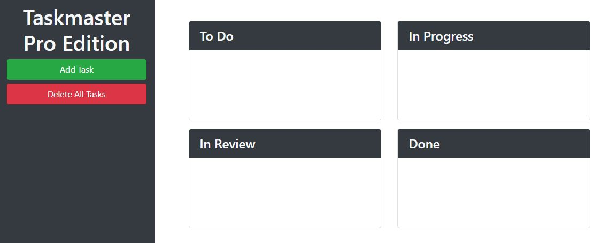

# TASKMASTER PRO

## 1. Description
A kanban-style task management app that lets you create, organize, and track tasks across a four-column workflow with automatic due date highlighting.

DEPLOYMENT: https://cbushehry.github.io/taskmaster-pro/

## 2. Features
 * Create tasks with a description and due date via a modal form
 * Four-column kanban board: To Do, In Progress, In Review, and Done
 * Drag and drop tasks between columns or onto the trash zone to delete individually
 * Inline editing — click any task's text or due date to edit it directly
 * Due date color coding: yellow when due within 2 days, red when overdue
 * Due dates are automatically re-audited every 30 minutes
 * Task data is persistent thanks to localStorage
 * Delete All button to clear every task at once

 

## 3. Credits / Contact Info
This application was created by Cameron Bushehry

  
  
